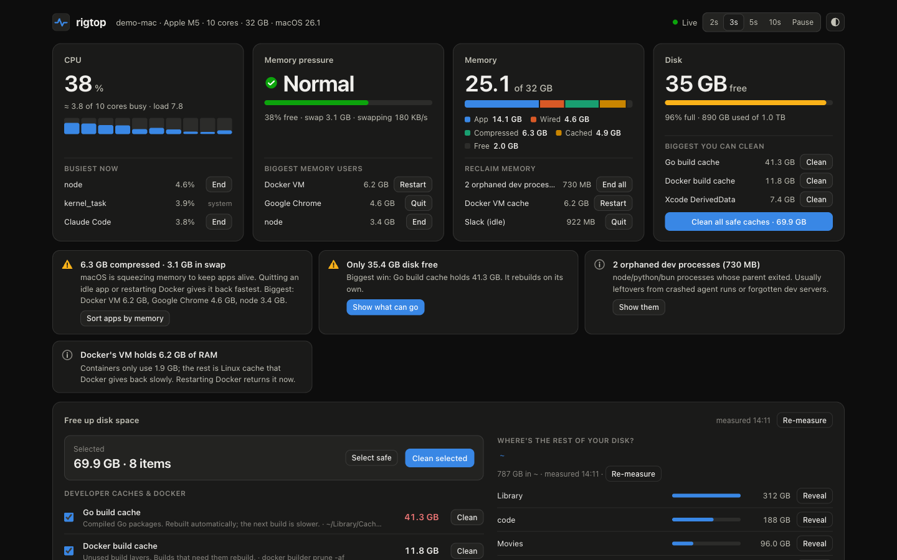
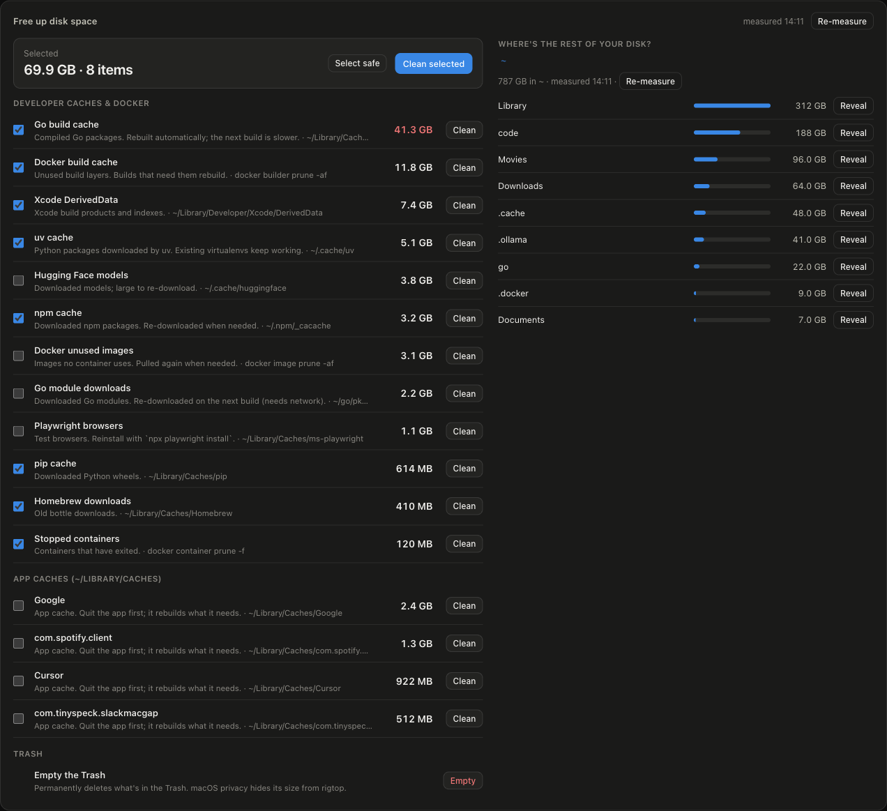
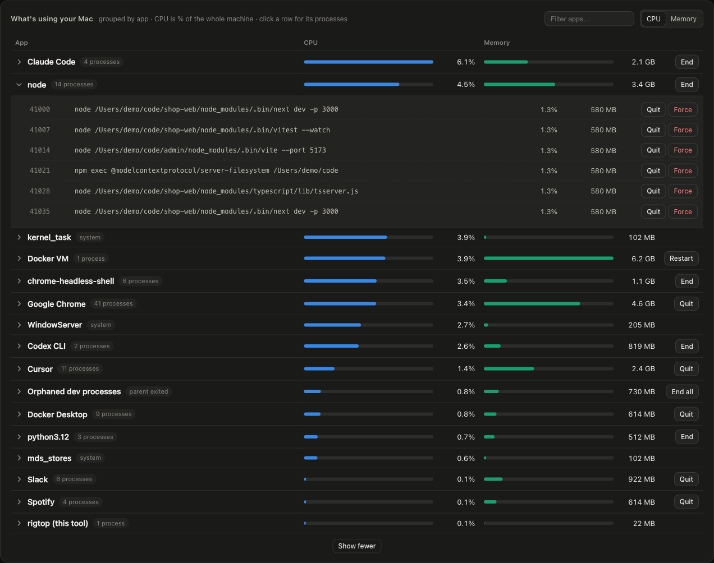
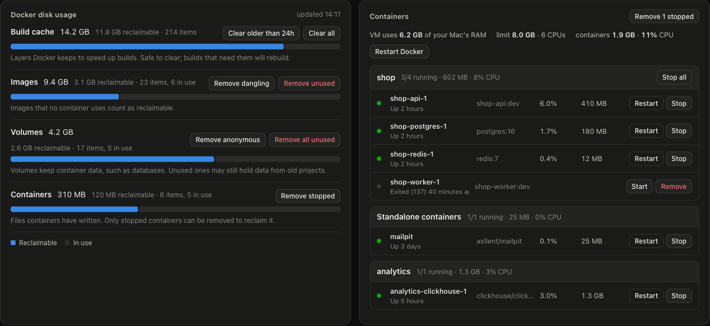
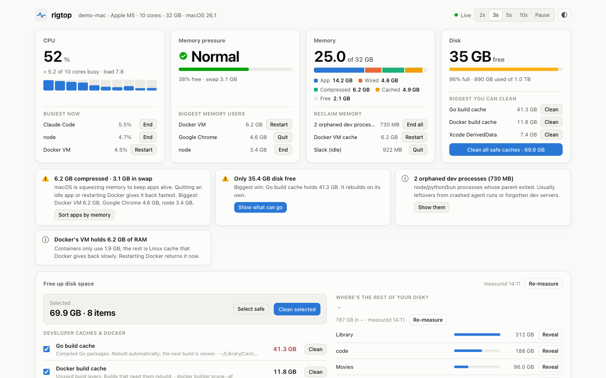
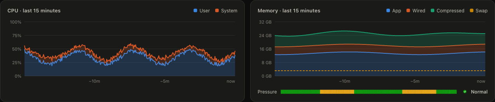

# rigtop

**`top` for dev machines that run AI coding agents and Docker all day.**
A live terminal status line and a local web dashboard showing what's straining your machine, with one-tap fixes to free memory and disk.

   

```bash
git clone https://github.com/alonstech/rigtop && cd rigtop && ./rigtop
```

No install, no `pip`, no Homebrew. One Python file and one HTML file.



<sub>Screenshots are from `./rigtop --demo`, which shows made-up data.</sub>

---

## Why this exists

A typical day now looks like this: three or four coding agents running in parallel (Claude Code, Codex, Gemini, Cursor…), each starting its own dev servers, test runners and headless browsers, while a Docker stack runs alongside. On a 32 GB laptop that adds up quickly:

- **Memory quietly runs out.** macOS compresses RAM, then swaps to disk, and everything gets sluggish long before Activity Monitor looks alarming.
- **Docker's VM keeps memory it no longer needs.** Containers use 300 MB while the VM holds 7 GB of Linux page cache.
- **Agents leave processes behind.** A crashed or cancelled run leaves `node`, `python` and `vite` processes owned by no one, still holding memory and ports.
- **Caches grow without anyone noticing.** The machine rigtop was built on had **103 GB of Go build cache**, 10 GB of Docker build cache and 4.5 GB of uv cache, and only 27 GB of free disk.

The usual tools each cover part of this. Activity Monitor, `btop` and Glances *show* the load. CleanMyMac, Mole and kondo *clean*, but from a separate command or app. None of them knows that `node` with a dead parent is probably a leftover agent, or that the Docker VM is the real memory hog.

rigtop puts the picture and the fix on one screen. You see what's wrong and fix it with two taps, without leaving the dashboard and without adding load to a machine that's already struggling.

## Quick start

```bash
git clone https://github.com/alonstech/rigtop
cd rigtop
./rigtop
```

Your browser opens the dashboard at a private link (`http://127.0.0.1:7777/#k=…`), and the terminal shows a live line:

```
● rigtop http://127.0.0.1:7777  CPU  47% ▮▮▮▮▯▯▯▯  MEM 26.1/32 GB  pressure normal  swap 2.9 GB  disk 41.0 GB free  docker 3 up · cache 9.8 GB  dashboard open
```

**Requirements:** macOS or Linux with Python 3.9+. Docker is optional.

- **macOS:** the Python that ships with Xcode Command Line Tools (`/usr/bin/python3`) is enough; if you don't have it, run `xcode-select --install`.
- **Linux:** the distribution's `/usr/bin/python3`. Kernel 4.20+ gives rigtop real memory-pressure readings (PSI); on older kernels it falls back to available memory. `ionice`, `gio` and `gdbus` are used when present (they ship with util-linux and GLib on every mainstream desktop).

The launcher always uses that system Python, so asdf, pyenv or an active virtualenv can't get in the way.

If you close the tab, reopen the link printed in the terminal. The key changes every time rigtop starts.

To run it from anywhere:

```bash
ln -s "$(pwd)/rigtop" ~/.local/bin/rigtop
```

| Option | Default | What it does |
|---|---|---|
| `--no-open` | off | Don't open a browser tab. Open the link rigtop prints instead |
| `--once` | off | Print a text snapshot and exit. Handy inside an agent session or a script |
| `--port N` | `7777` | Port to listen on (moves up automatically if it's taken) |
| `--interval S` | `3` | Seconds between samples while the dashboard is open |
| `--docker-interval S` | `10` | Seconds between `docker stats` calls while the dashboard is open |
| `--demo` | off | Show made-up data instead of your machine's. Every button is a no-op. Useful for screenshots, demos and UI work |

## What you get

### Screenshots

| Free up disk space | What's using your Mac |
|---|---|
|  |  |
| **Docker** | **Light mode** |
|  |  |



### Features

**Four tiles, each with an action.** Every tile ends in a short list of the things worth acting on:

| Tile | Shows | One-tap actions |
|---|---|---|
| **CPU** | Whole-machine %, per-core bars, load | The 3 busiest apps → Quit / End |
| **Memory pressure** | The kernel's own Normal / Elevated / Critical level, swap, swap rate | The 3 biggest memory users → Quit / End |
| **Memory** | App / Wired / Compressed / Cached / Free (Activity Monitor's math) | Orphaned dev processes → End all · Docker VM cache → Restart Docker · Idle apps holding RAM → Quit |
| **Disk** | Free space and % used | The 3 biggest cleanable items → Clean · **Clean all safe caches** |

**Free up disk space.** One list of everything that's safe to throw away, measured at background priority:

- **Developer caches:** Go build and modules, npm, uv, pip, Yarn, Bun, Homebrew, Cargo, Xcode DerivedData, iOS Simulator, Playwright, Gradle, Maven, Hugging Face.
- **Docker:** build cache, unused images, stopped containers.
- **App caches:** the biggest folders in `~/Library/Caches`.
- **Trash.**

Tick what you want and press **Clean selected**. Caches that tools rebuild on their own come pre-ticked.

**Where's the rest of your disk?** A read-only folder explorer for your home folder: measure, drill down, then Reveal in Finder. rigtop never deletes anything you browse here.

**What's using your Mac.** Processes grouped by app, so 37 Chrome helpers show as one "Google Chrome" and Claude Code, Codex and the Docker VM each get a line of their own. Expand any row to see full command lines, each with Quit and Force quit.

**Docker.** Disk usage with prune buttons, containers grouped by compose project with Stop / Restart / Start / Remove, and how much of your Mac's RAM the Docker VM really holds compared with what the containers report.

**Suggestions.** Plain-language notes such as *"Only 41 GB disk free. Biggest win: Go build cache holds 104 GB."* or *"Docker's VM holds 7.3 GB but containers use 344 MB."*, each with a button that goes straight to the fix.

**History.** 15 minutes of CPU, memory, swap and pressure, with hover tooltips.

## Built to be light

A monitor for an overloaded machine must not add to the load.

- **No dependencies.** Python standard library only.
- **No polling subprocesses for the basics.** CPU, memory, pressure and swap come straight from the kernel: the Mach APIs through `ctypes` on macOS, `/proc` files on Linux. Nothing runs `top`, `vm_stat` or `free`.
- **Heavier work only while you're looking.** `ps` and the Docker CLI run only while a dashboard tab is open *and visible*. A hidden tab stops polling entirely.
- **Background priority for disk work.** Cache measurement (`du`) and cleanups run under `taskpolicy -b` on macOS (its lowest I/O and CPU tier) or `ionice -c3 nice -n19` on Linux, off the web thread.
- **Nothing written to disk.** History lives in memory.

| | rigtop's CPU | rigtop's memory |
|---|---|---|
| M5 MacBook Pro, dashboard open (`ps` + `docker stats` included) | ≈ 0.1% of the machine | ~24 MB |
| M5 MacBook Pro, dashboard closed (terminal line only) | ≈ 0% | ~22 MB |
| 4-core Intel i5-2400 (2011) on Ubuntu, dashboard open (~300 processes, 13 containers) | ≈ 0.4% of the machine | ~33 MB |

## Safety

rigtop can delete files and end processes, so it's deliberately conservative.

- **Two taps for quick actions.** The first tap arms the button (it turns red), the second within 3.5 s runs it. Anything that can lose data (unused Docker volumes, all unused images, emptying the Trash, restarting Docker) opens a dialog showing the exact command instead.
- **Fixed allow-lists.** Docker commands and cache folders come from fixed lists in the code. Cache cleaning only empties known folders inside your home folder and never follows symlinks.
- **Careful with processes.** rigtop only signals processes you own. It never touches macOS system agents (`/System`, `/usr`…) or the Linux desktop's own services (anything systemd runs in your session, such as GNOME Shell or PipeWire), itself, or the terminal that launched it, and it checks a pid still belongs to the same program before signalling it. Coding agents and terminals are never suggested as "idle", because waiting for input looks idle.
- **Local and private.** The server listens on `127.0.0.1` only and rejects requests with any other `Host` header (DNS-rebinding protection). Each run creates a secret key that only appears in the link rigtop opens and prints, after the `#`, which browsers never send to any server. The page keeps the key in storage that belongs only to rigtop's own address and port, and sends it as a header on every request. No cookies are used, because browsers send cookies to every port on `127.0.0.1`. Actions also need a same-origin check. Other user accounts on the same machine, your other local dev servers and other websites can't read your process list or trigger anything.
- **No root.** No `sudo`, no privileged helpers.

## Similar tools

rigtop is small and focused. If these fit you better, use them:

- [**Mole**](https://github.com/tw93/Mole): a thorough macOS cleaner, uninstaller and monitor CLI.
- [**Glances**](https://github.com/nicolargo/glances): a cross-platform monitor with a web UI and Docker support.
- [**btop**](https://github.com/aristocratos/btop): a beautiful terminal resource monitor.
- [**kondo**](https://github.com/tbillington/kondo): cleans project build artifacts such as `node_modules` and `target/`.

rigtop's angle is the combination of a live view plus one-tap fixes, tuned for agent-heavy and Docker-heavy development machines.

## Platform support

| Platform | Status |
|---|---|
| macOS (Apple Silicon) | ✅ Supported, and where it's developed |
| macOS (Intel) | Should work (same kernel APIs); reports welcome |
| Linux | ✅ Supported. Tested on Ubuntu 26.04 (GNOME, Docker Engine); reports from other distros and desktops welcome |
| Windows | 💭 Not yet. Needs a Win32 backend; Docker Desktop runs in WSL2 there |

### How rigtop reads Linux

The tiles mean the same thing on both systems, but Linux gets its numbers differently:

- **CPU, memory, swap:** `/proc/stat`, `/proc/meminfo` and `/proc/vmstat`, read as plain files with no forks. *Kernel* stands in for macOS's *Wired* (unreclaimable slab, kernel stacks, page tables); *Compressed* is zswap plus zram; *Cached* is page cache the kernel can drop.
- **Memory pressure:** `/proc/pressure/memory` (PSI), which measures how long tasks actually stalled on memory, combined with `MemAvailable`.
- **Processes:** read from `/proc` directly instead of `ps`, so CPU % reflects the last few seconds (procps' `ps` reports a lifetime average). Orphans are found under PID 1 *or* your `systemd --user`, which adopts them on most desktops. Desktop services that systemd runs for you (GNOME Shell, PipeWire, portals…) are recognised from their cgroup and are never offered for ending.
- **Docker:** with Docker Engine, containers run on the host, so they show as one *Docker containers* line (found by cgroup) next to *Docker Engine*, and there's no VM to restart. Docker Desktop for Linux keeps its VM line and restart button.
- **Disk and cleanup:** free space is for the filesystem holding your home folder, caches come from `~/.cache` (`$XDG_CACHE_HOME`), cleanups run under `ionice -c3 nice -n19`, the Trash is the freedesktop.org one (emptied with `gio trash --empty`, and rigtop can show its size), and Reveal asks your file manager over D-Bus.
- **Quit:** Linux has no portable "please quit" message for apps, so apps offer **End** (`SIGTERM`, which browsers and editors treat as a normal shutdown) instead of **Quit**.

## Roadmap ideas

- Windows backend
- Group processes by **agent session or worktree** ("this Claude session and its dev servers use 4 GB")
- Find stale `node_modules` / `.venv` / `target/` folders in old projects
- Alerts: a macOS notification when pressure turns critical or disk drops below a threshold
- Per-agent token or cost overlays, for agents that expose them

## Contributing

Contributions are very welcome: bug reports, new cache locations, platform backends, UI polish and docs. Start with [CONTRIBUTING.md](CONTRIBUTING.md). It explains how the code is laid out, how to add a cleanup target, and the few rules that keep rigtop light and safe.

If rigtop freed some disk or rescued a laggy afternoon for you, a ⭐ helps other people find it.

## License

[MIT](LICENSE)
